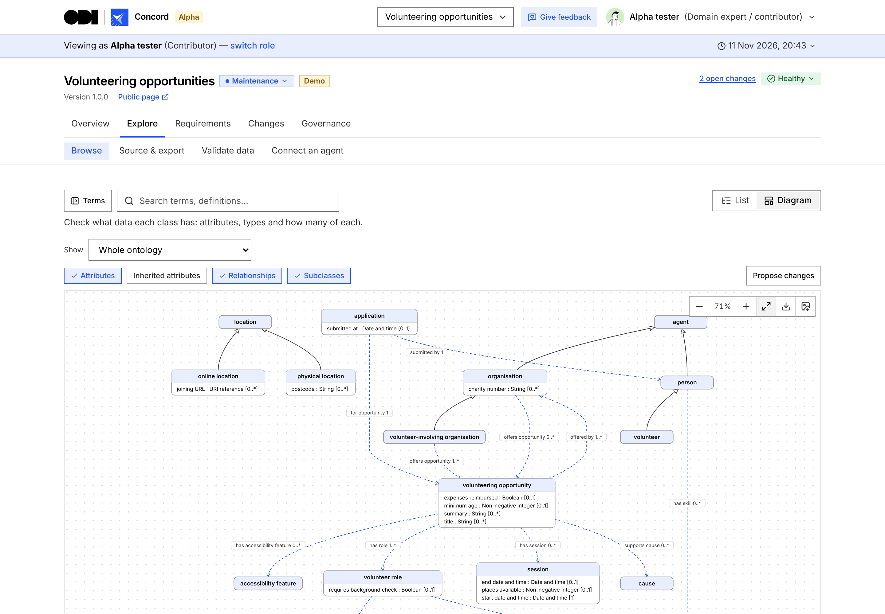

# Concord

Concord, from the Open Data Institute, is where working groups design open data standards together. Each standard is a strict OWL 2 ontology. Requirements come in from interviews, meeting transcripts and coding agents, and every proposed change is checked, then reviewed or voted on under rules the group sets for itself, without needing a meeting.

**Try it at [standards-concord.vercel.app](https://standards-concord.vercel.app).** Alpha testers start at [/alpha](https://standards-concord.vercel.app/alpha).

## Learn more

- [What Concord does](docs/features.md)
- [Run, test and deploy it](docs/development.md)
- [Connect a coding agent, use development forks and test apps against changes](docs/agents.md)
- [Working on Concord](CLAUDE.md)

## Cite Concord

If you use Concord in your research, please cite it as [doi:10.5281/zenodo.24450045](https://doi.org/10.5281/zenodo.24450045), which always points at the latest release (each release also has its own DOI on Zenodo). GitHub's **Cite this repository** button (from [CITATION.cff](CITATION.cff)) gives APA and BibTeX.

## Licence

[MIT](LICENSE). The Open Data Institute's name and logo and the [third-party logos](docs/third-party-marks.md) are trademarks of their owners and aren't covered by the licence.
