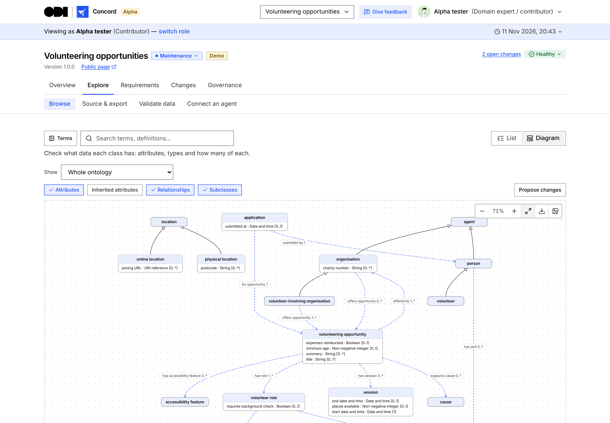

# Concord

Concord, from the Open Data Institute, is where working groups design open data standards together. Each standard is a strict OWL 2 ontology. Requirements come in from interviews, meeting transcripts and coding agents, and every proposed change is checked, then reviewed or voted on under rules the group sets for itself, without needing a meeting.

**Try it at [standards-concord.vercel.app](https://standards-concord.vercel.app).** Alpha testers start at [/alpha](https://standards-concord.vercel.app/alpha).

## Learn more

- [What Concord does](docs/features.md)
- [Run, test and deploy it](docs/development.md)
- [Connect a coding agent, use development forks and test apps against changes](docs/agents.md)
- [Working on Concord](CLAUDE.md)

## Licence

[MIT](LICENSE). The Open Data Institute's name and logo and the [third-party logos](docs/third-party-marks.md) are trademarks of their owners and aren't covered by the licence.

The demo includes converted [Solid ecosystem sample vocabularies](docs/sample-vocabularies.md) with their source, author and modification notices. W3C samples use the [W3C Software and Document License (2015)](https://www.w3.org/Consortium/Legal/2015/copyright-software-and-document), with the [full bundled notice](docs/licences/W3C-20150513.md) served at `/licences/W3C-20150513`. Modified FOAF credits Dan Brickley and Libby Miller under [CC BY 1.0](https://creativecommons.org/licenses/by/1.0/) ([full text](docs/licences/CC-BY-1.0.md)).
